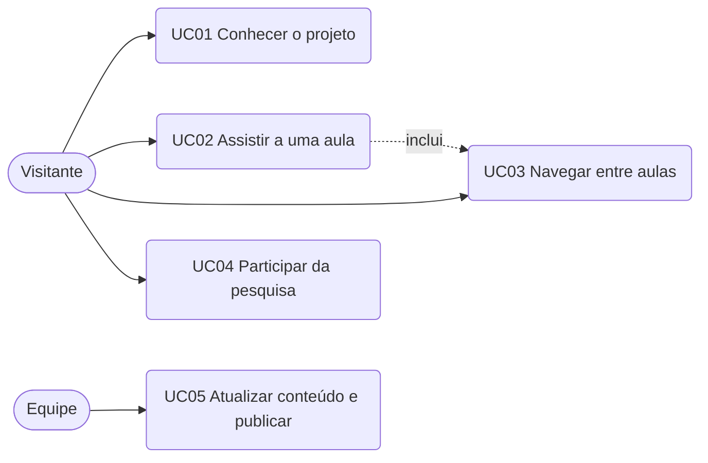
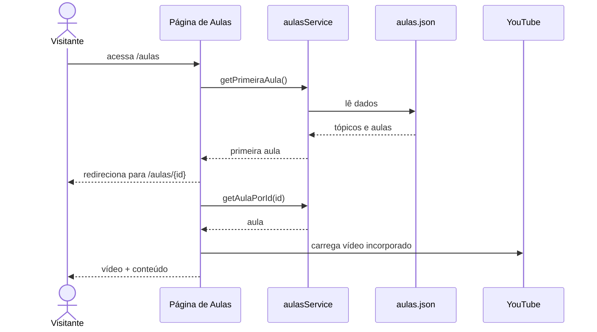

# Casos de Uso

## Atores
- **Visitante:** qualquer pessoa que acessa o site.
- **Equipe:** responsável por atualizar o conteúdo e o link da pesquisa.

## Diagrama

## Descrição dos casos de uso

### UC01 — Conhecer o projeto
- **Ator:** Visitante
- **Fluxo principal:** acessa a página inicial; lê a apresentação, os tópicos, o público-alvo e as perguntas frequentes.
- **Resultado:** entende o objetivo e pode seguir para as aulas ou a pesquisa.

### UC02 — Assistir a uma aula
- **Ator:** Visitante
- **Pré-condição:** existe ao menos uma aula cadastrada.
- **Fluxo principal:**
  1. O visitante acessa a página de aulas.
  2. O sistema abre a primeira aula.
  3. O visitante assiste ao vídeo e lê o conteúdo.
- **Fluxo alternativo:** se o visitante acessa o endereço de uma aula que não existe, o sistema exibe uma mensagem e mantém o menu disponível.
- **Pós-condição:** a aula escolhida fica destacada no menu.

### UC03 — Navegar entre aulas
- **Ator:** Visitante
- **Fluxo principal:** o visitante clica em uma aula no menu lateral; o sistema atualiza o endereço, o vídeo e o conteúdo.
- **Variação (celular):** o visitante abre o menu pelo botão, escolhe a aula e o menu se fecha.
- **Fluxo alternativo:** ao final da aula, o visitante usa os atalhos "Aula anterior" ou "Próxima aula"; o sistema abre a aula correspondente e volta ao topo da página.

### UC04 — Participar da pesquisa
- **Ator:** Visitante
- **Fluxo principal:** acessa a página de pesquisa, lê as informações e responde ao formulário incorporado.
- **Fluxo alternativo A:** se o formulário não carrega bem, usa o link para abrir em nova aba.
- **Fluxo alternativo B:** se o formulário não está configurado, o sistema exibe um aviso de indisponibilidade.

### UC05 — Atualizar conteúdo e publicar
- **Ator:** Equipe
- **Fluxo principal:** edita o arquivo de aulas (ou o link do formulário), executa os testes, faz commit; o deploy automático publica a nova versão.

## Sequência: assistir a uma aula

