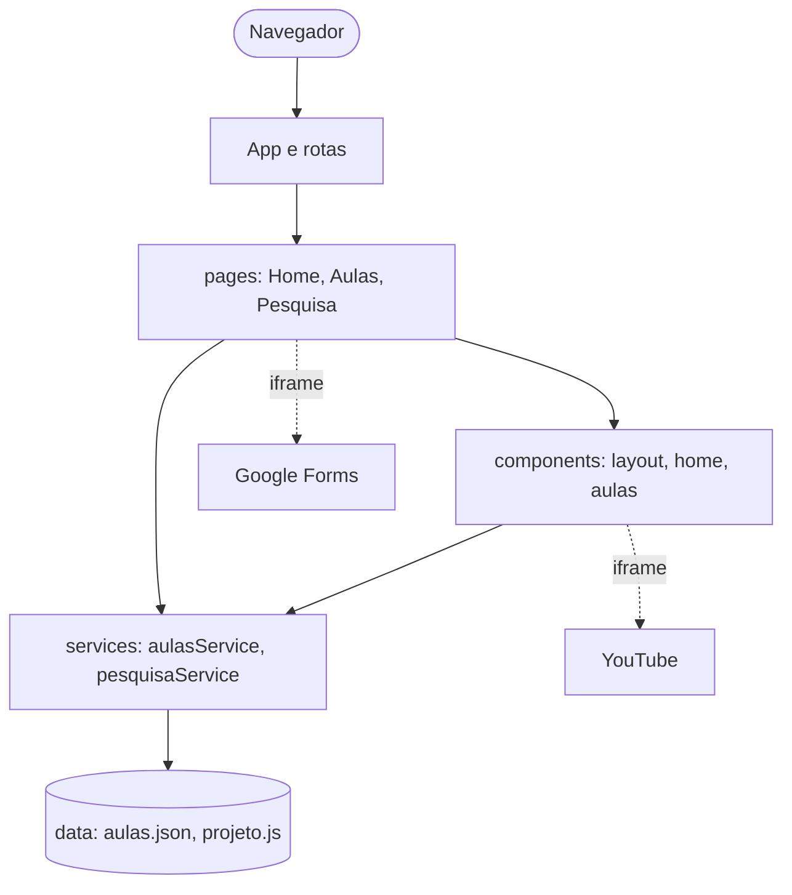
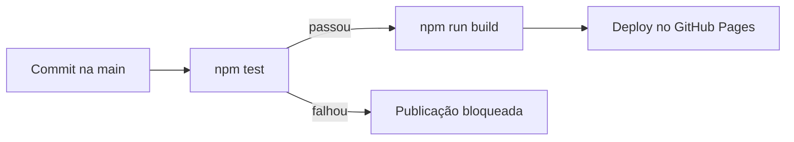

# Arquitetura

## 1. Visão geral
Aplicação web de página única (SPA) **estática**, sem back-end nem banco de
dados. O conteúdo vem de arquivos de dados incluídos no próprio projeto, e os
serviços externos (YouTube e Google Forms) são incorporados por iframe.

## 2. Camadas

| Camada | Responsabilidade |
|---|---|
| `pages` | Montam cada página e decidem o que exibir |
| `components` | Peças reutilizáveis de interface |
| `services` | Único ponto de acesso aos dados; regras de busca e validação |
| `data` | Conteúdo (aulas, textos do projeto, link do formulário) |
| `components/ui` | Peças genéricas reutilizáveis (botão, seção) |
| `styles` | Tema do site (cores) e importação do Tailwind |

## 3. Tecnologias
| Item | Escolha |
|---|---|
| Interface | React |
| Build/dev server | Vite |
| Rotas | React Router (HashRouter) |
| Testes | Vitest |
| Versionamento | Git e GitHub |
| CI/CD e hospedagem | GitHub Actions e GitHub Pages |
| Estilo | Tailwind CSS (v4, via plugin do Vite) |

## 4. Decisões arquiteturais
| ID | Decisão | Motivo |
|---|---|---|
| AD01 | Site estático, sem back-end | Conteúdo não muda por usuário; custo zero e manutenção simples (RNF04, RNF05) |
| AD02 | React com Vite | Componentização e familiaridade da equipe; build rápido |
| AD03 | HashRouter | O GitHub Pages não redireciona rotas internas; com `#` a atualização da página não gera erro 404 |
| AD04 | Conteúdo em `aulas.json` | Adicionar aula sem alterar código; home e menu se geram do mesmo dado |
| AD05 | Acesso aos dados só via `services` | Se a fonte mudar, apenas a camada de serviço muda |
| AD06 | Vídeo via `youtube-nocookie.com` | Reduz o uso de cookies de terceiros |
| AD07 | Forms incorporado com link alternativo | Mantém o visitante no site, com alternativa para celulares ou falhas |
| AD08 | Deploy por GitHub Actions com testes | Publicação automática e protegida por testes |
| AD09 | Tailwind CSS com componentes reutilizáveis | Estilo consistente e minimalista, sem arquivos CSS por página; as classes repetidas ficam concentradas em componentes (`Botao`, `Secao`) e as cores em um único bloco de tema |
| AD10 | Conteúdo das aulas em arquivos Markdown, para facilitar a edição por quem não programa e permitir imagens e formatação |

## 5. Fluxo de entrega

## 6. Limitações conhecidas
- O site depende da disponibilidade do YouTube e do Google Forms.
- Não há acompanhamento de progresso do aluno.
- O Google Forms não pode ser estilizado por dentro.